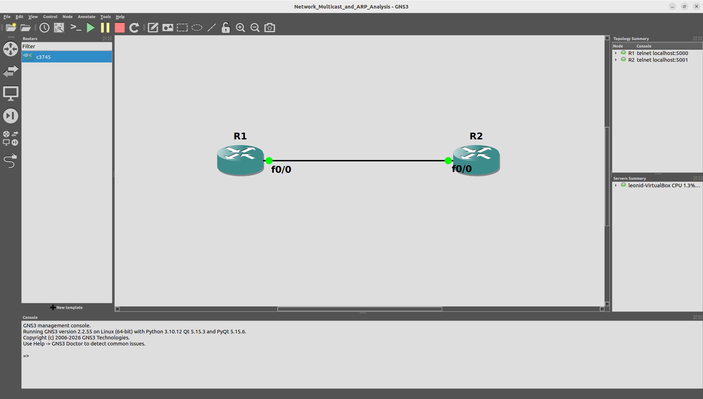
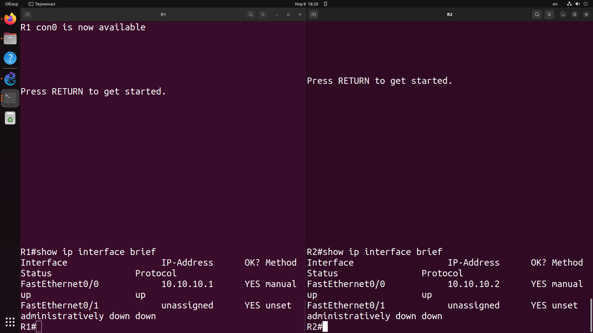
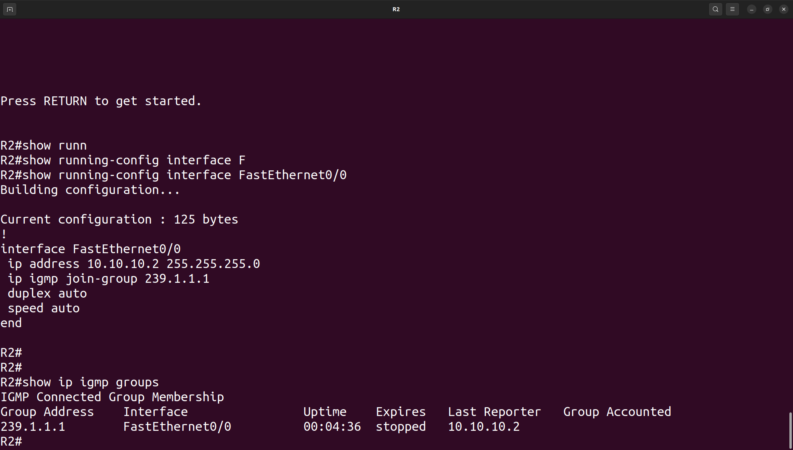
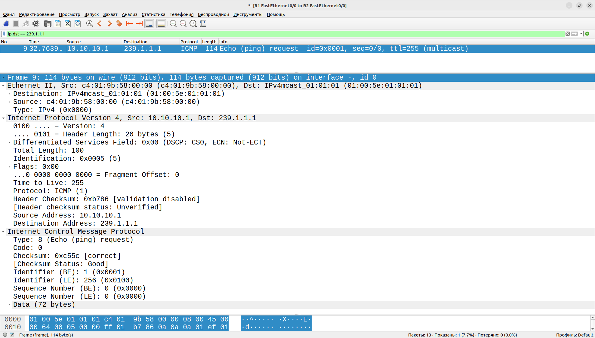
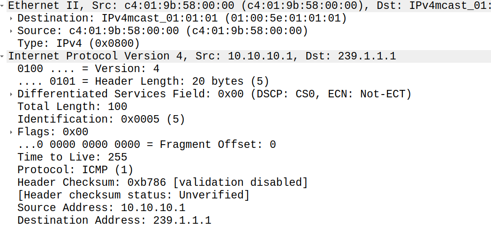
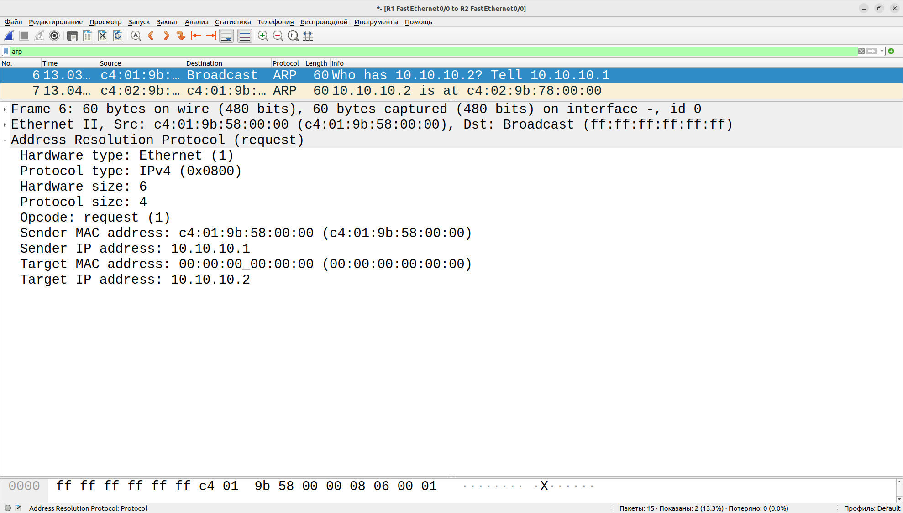
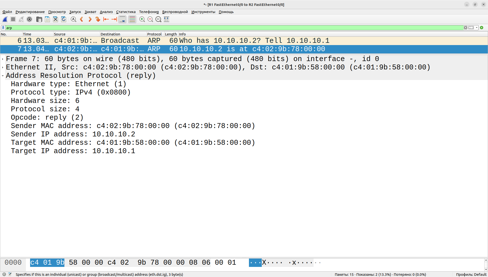
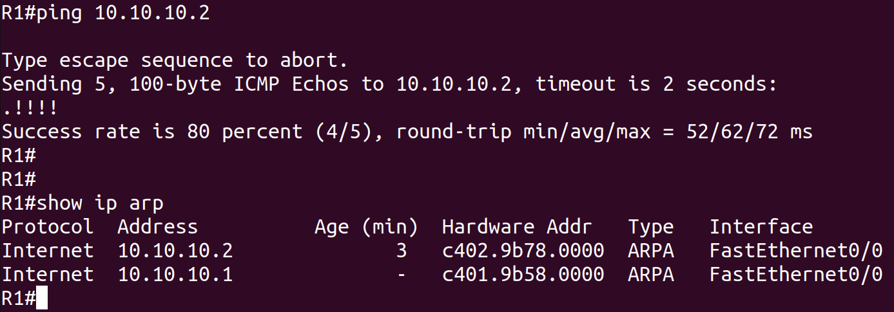
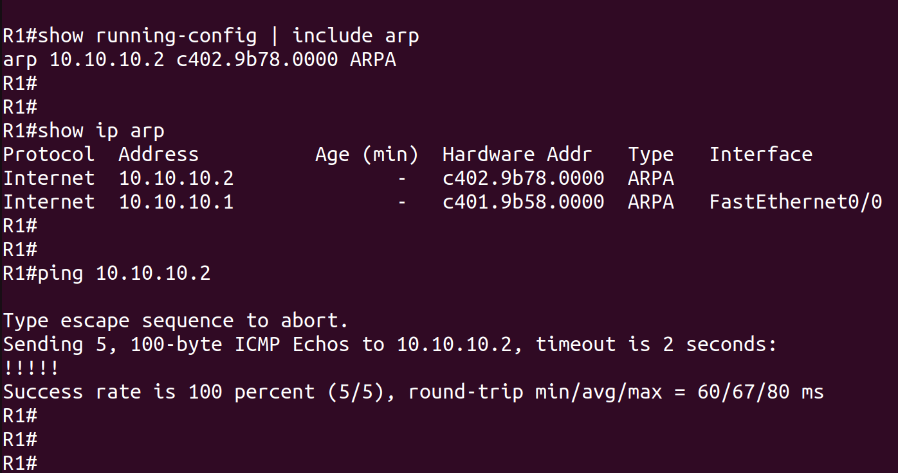
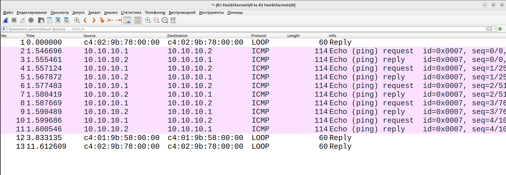

# Network Multicast and ARP Analysis — Technical Report

## 1. Обзор проекта

В рамках проекта исследованы механизмы multicast-взаимодействия и разрешения IP-адресов в MAC-адреса с использованием протоколов ICMP и ARP.

Практическая работа выполнена в GNS3 с использованием двух маршрутизаторов Cisco 3745. Для проверки сетевого взаимодействия и анализа передаваемых пакетов использовался Wireshark.

Дополнительно исследована работа статических ARP-записей как одного из способов закрепления соответствия между IP- и MAC-адресами на сетевом устройстве.

### Цели

- Изучить принципы передачи multicast-трафика.
- Исследовать структуру Ethernet-, IPv4- и ICMP-пакетов.
- Изучить механизм ARP Request и ARP Reply.
- Проверить формирование и содержимое ARP-таблицы.
- Настроить статическую ARP-запись.
- Сравнить поведение ARP до и после настройки статического соответствия.
- Получить практический опыт анализа сетевого трафика в Wireshark.

## 2. Лабораторное окружение

### Используемые инструменты

| Компонент | Назначение |
|---|---|
| GNS3 | Эмуляция сетевой топологии |
| Cisco 3745 | Маршрутизаторы |
| Cisco IOS CLI | Настройка сетевых интерфейсов и протоколов |
| Wireshark | Захват и анализ сетевого трафика |
| PCAP | Сохранение сетевых трассировок |

### Топология

Лабораторная топология состоит из двух маршрутизаторов Cisco 3745, соединённых напрямую через Ethernet-интерфейсы.

Для взаимодействия между устройствами использовалась сеть `10.10.10.0/24`.

| Устройство | Интерфейс | IP-адрес |
|---|---|---|
| R1 | FastEthernet0/0 | 10.10.10.1/24 |
| R2 | FastEthernet0/0 | 10.10.10.2/24 |

**Скриншот — топология GNS3**



**Скриншот — IP-адресация и состояние интерфейсов**



После настройки адресации проверено состояние интерфейсов. Оба интерфейса находились в состоянии `up/up`. Связность между маршрутизаторами проверена с помощью ICMP Echo Request.

---

## 3. Multicast-запросы

### 3.1. Настройка multicast-группы

Для исследования multicast-взаимодействия использовался адрес:

`239.1.1.1`

На интерфейсе маршрутизатора R2 настроено присоединение к multicast-группе с помощью команды:

```cisco
interface FastEthernet0/0
ip igmp join-group 239.1.1.1
```

Команда `ip igmp join-group` позволяет интерфейсу присоединиться к указанной multicast-группе.

**Скриншот — настройка multicast-группы**



### 3.2. Генерация и захват трафика

После настройки multicast-группы с маршрутизатора R1 отправлены ICMP-запросы на адрес `239.1.1.1`.

Захват сетевого трафика выполнялся на соединении между маршрутизаторами с последующим анализом в Wireshark.

Для фильтрации ICMP-пакетов использовался display filter:

```wireshark
icmp
```

Дополнительно применялся фильтр для отображения пакетов с конкретным multicast-адресом назначения:

```wireshark
ip.dst == 239.1.1.1
```

### 3.3. Анализ Ethernet, IPv4 и ICMP

В Wireshark исследованы основные поля заголовков передаваемого пакета.

**Ethernet II:**
- Source MAC — MAC-адрес отправителя.
- Destination MAC — MAC-адрес получателя.

**IPv4:**
- Source Address — IP-адрес источника.
- Destination Address — multicast-адрес `239.1.1.1`.

**ICMP:**
- Type — тип ICMP-сообщения.
- Code — код сообщения.
- Checksum — контрольная сумма.

Для multicast IP-адреса `239.1.1.1` в захваченном Ethernet-кадре использовался MAC-адрес:

`01:00:5e:01:01:01`

Это multicast MAC-адрес, соответствующий исследуемому IPv4 multicast-адресу.

**Скриншот — ICMP multicast-пакет**



**Скриншот — подробная информация о multicast-пакете**



### 3.4. Результат

В ходе работы исследована передача ICMP-трафика на multicast-адрес. В Wireshark изучены Ethernet-, IPv4- и ICMP-заголовки, а также соответствие multicast IP-адреса Ethernet MAC-адресу.

---

## 4. ARP — Address Resolution Protocol

### 4.1. Подготовка к анализу

Для исследования ARP предварительно очищен ARP-кэш маршрутизаторов.

Использовалась команда:

```cisco
clear arp-cache
```

После очистки таблицы выполнена проверка её содержимого:

```cisco
show ip arp
```

Затем на маршрутизаторе R1 выполнен ping до IP-адреса R2:

```cisco
ping 10.10.10.2
```

Это позволило инициировать процесс разрешения IP-адреса в MAC-адрес.

### 4.2. Анализ ARP Request

При отсутствии соответствующей записи в ARP-таблице отправитель формирует ARP Request для определения MAC-адреса устройства с известным IP-адресом.

В Wireshark исследованы основные поля ARP Request:

- Sender MAC Address — MAC-адрес отправителя.
- Sender IP Address — IP-адрес отправителя.
- Target MAC Address — MAC-адрес искомого устройства.
- Target IP Address — IP-адрес устройства, MAC-адрес которого необходимо определить.

Первый ARP Request отправляется на широковещательный MAC-адрес:

`ff:ff:ff:ff:ff:ff`

Этот адрес называется Ethernet Broadcast Address. Кадр предназначен для всех устройств в пределах соответствующего широковещательного домена.

**Скриншот — ARP Request**



### 4.3. Анализ ARP Reply

После получения ARP Request устройство с соответствующим IP-адресом отправляет ARP Reply.

В ответном сообщении содержится MAC-адрес, соответствующий запрашиваемому IP-адресу.

В Wireshark исследованы поля отправителя и получателя ответного ARP-пакета.

**Скриншот — ARP Reply**



### 4.4. Проверка ARP-таблицы

После выполнения ping повторно проверена ARP-таблица маршрутизатора:

```cisco
show ip arp
```

В таблице появилась динамическая запись, содержащая соответствие IP-адреса соседнего маршрутизатора и его MAC-адреса.

Полученное соответствие сопоставлено с информацией из ARP Reply в Wireshark.

**Скриншот — ARP Table**



### 4.5. Результат

Исследован процесс разрешения IP-адреса в MAC-адрес. Проанализированы ARP Request и ARP Reply, изучены адреса отправителя и получателя, а также проверено появление динамической записи в ARP-таблице.

---

## 5. Static ARP — статические ARP-записи

### 5.1. Назначение статических ARP-записей

По умолчанию соответствия между IP- и MAC-адресами могут формироваться динамически в процессе сетевого взаимодействия.

Статическая ARP-запись позволяет вручную закрепить соответствие IP-адреса и MAC-адреса на конкретном сетевом устройстве.

В рамках дополнительной практической части исследована настройка статического соответствия для соседнего маршрутизатора.

### 5.2. Настройка статической записи

На R1 добавлена статическая ARP-запись для IP-адреса R2:

```cisco
configure terminal
arp 10.10.10.2 XXXX.XXXX.XXXX arpa
end
write memory
```

Вместо `XXXX.XXXX.XXXX` использован фактический MAC-адрес интерфейса R2.

После настройки проверено содержимое ARP-таблицы:

```cisco
show ip arp
```

Дополнительно проверена конфигурация:

```cisco
show running-config | include arp
```

**Скриншот — настройка статической ARP-записи и ARP Table**



### 5.3. Проверка работы статической записи

После добавления статической записи выполнен повторный ping с R1 до R2:

```cisco
ping 10.10.10.2
```

Связность между маршрутизаторами сохранилась.

Для проверки поведения протокола выполнен дополнительный захват сетевого трафика в Wireshark.

При анализе захвата установлено, что для уже заданного статического соответствия IP–MAC новый ARP Request не потребовался. Передача ICMP-пакетов продолжилась.

**Скриншот — сетевой трафик после настройки Static ARP**



### 5.4. Сравнение динамического и статического ARP

| Характеристика | Dynamic ARP | Static ARP |
|---|---|---|
| Формирование записи | Автоматически при разрешении адреса | Вручную администратором |
| Изменение соответствия | Может обновляться динамически | Задаётся вручную |
| ARP Request | Может потребоваться при отсутствии записи | Не требуется для уже заданного соответствия |
| Область действия | Конкретное устройство | Конкретное устройство |

### 5.5. Ограничения Static ARP

Статическая ARP-запись позволяет закрепить соответствие IP–MAC на отдельном устройстве, но не обеспечивает полноценную защиту всей сети от ARP-spoofing.

Для её применения в реальной инфраструктуре необходимо учитывать масштаб сети и особенности управления ARP-записями на конечных устройствах и сетевом оборудовании.

### 5.6. Результат

Настроена статическая ARP-запись на R1. Проверены её наличие в ARP-таблице и сохранение сетевой связности. Сравнено поведение сетевого взаимодействия до и после настройки статического соответствия.

---

## 6. ARP и безопасность сети

ARP является важным механизмом локального сетевого взаимодействия, однако особенности его работы могут использоваться злоумышленниками.

Одной из угроз является **ARP-spoofing** — подмена ARP-сообщений с целью формирования некорректных соответствий между IP- и MAC-адресами.

Такая подмена может использоваться для создания условий проведения атак типа **Man-in-the-Middle (MITM)**, при которых злоумышленник пытается перехватывать или перенаправлять сетевой трафик.

Для аналитика SOC понимание нормального поведения ARP важно при исследовании сетевых событий и поиске подозрительных изменений соответствий IP–MAC.

В рамках проекта ARP-spoofing и MITM рассматривались только как потенциальные угрозы. Практическая реализация атак не выполнялась.

Настройка статической ARP-записи продемонстрировала один из ограниченных способов закрепления соответствия IP–MAC. Она не является полноценной заменой специализированным механизмам защиты коммутаторов, например Dynamic ARP Inspection.

---

## 7. Итоговые результаты

В ходе проекта:

- Создана лабораторная топология из двух маршрутизаторов Cisco 3745.
- Настроена IP-адресация и проверена связность между устройствами.
- Исследована передача ICMP-трафика на multicast-адрес.
- Проанализированы Ethernet-, IPv4- и ICMP-заголовки.
- Изучено соответствие multicast IP-адреса и Ethernet MAC-адреса.
- Исследованы ARP Request и ARP Reply.
- Проверено формирование динамических ARP-записей.
- Настроена и проверена статическая ARP-запись.
- Сравнено поведение ARP до и после настройки статического соответствия.
- Исследованы потенциальные риски ARP-spoofing и MITM с точки зрения сетевой безопасности.

Результаты лабораторной работы сохранены в виде проекта GNS3, PCAP-дампов и скриншотов.

## 8. Полученные знания и навыки

В результате выполнения проекта получен практический опыт:

- Работы с виртуальной сетевой инфраструктурой в GNS3.
- Настройки интерфейсов маршрутизаторов Cisco IOS.
- Исследования multicast-взаимодействия.
- Анализа Ethernet-, IPv4-, ICMP- и ARP-пакетов.
- Работы с ARP-таблицами и статическими ARP-записями.
- Захвата и анализа сетевого трафика в Wireshark.
- Интерпретации сетевых событий с учётом потенциальных угроз безопасности.

